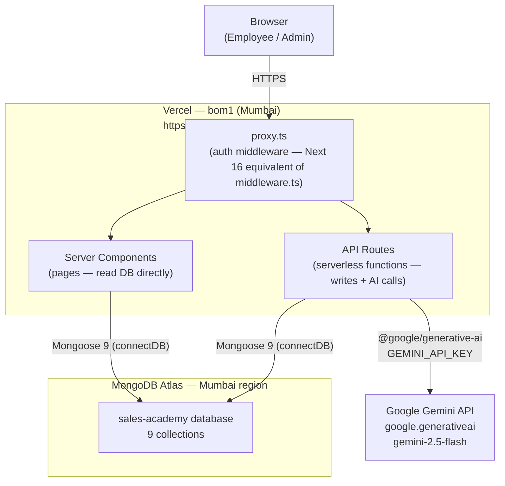
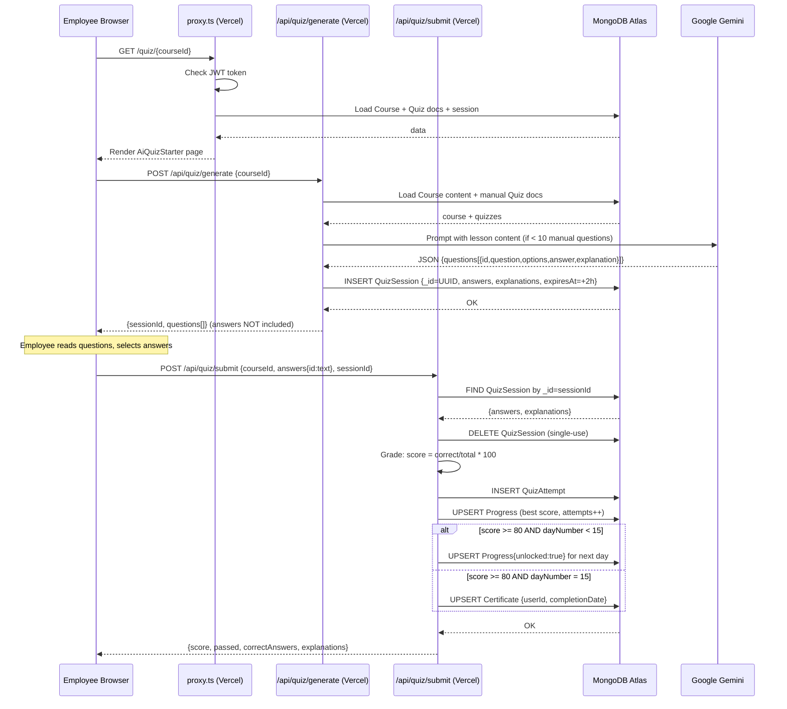

# Sales Academy — Technical Handoff

**Prepared by:** Samarth Naik  
**Prepared for:** Apram (incoming technical owner)  
**Date:** 2026-10-09  
**Status:** Working in production

---

## 1. Summary

Sales Academy is a 15-day online sales-training platform built for Mohidin. New joiners work through one lesson per day, watch videos, read content, and pass a quiz (minimum 80%) before the next day unlocks. Managers can track progress and quiz scores through an admin dashboard. The app is live at **https://sales-academy-eta.vercel.app** and has been running in production since October 2026.

**Three things the new owner must know first:**

1. **The Vercel account and MongoDB Atlas cluster are under Samarth's personal accounts.** Until they are transferred to a Mohidin-owned account, Apram cannot deploy new versions and risks losing access if Samarth's accounts change. This is the most urgent action item.
2. **The Google Gemini API key is billed to `info@mohidins.com`.** This one is already on a company account.
3. **Development and production share one MongoDB database.** Running the app locally with the default `.env.local` writes to live data. Treat the local dev server with care.

---

## 2. Purpose and Use Case

Sales Academy standardises onboarding for new sales staff at Mohidin. A fixed 15-day curriculum ensures every joiner completes the same training before a certificate is issued.

**Who uses it:**
- **New joiners (employees):** complete one day per day, take quizzes, earn a certificate on Day 15.
- **Managers (admins):** upload course content, create quizzes, post announcements, and track who is behind or struggling.

**Typical employee session:**
1. Log in at `/login` with username or email.
2. The dashboard shows a resume banner ("continue where you left off"), progress percentage, and all days in a searchable grid.
3. Open a day — watch the videos, read through each module in the LessonViewer, take private notes.
4. Once every module is marked read (in-browser only), click the quiz link.
5. Accept the rules, generate the quiz (if AI-backed), answer all questions, submit.
6. Pass (≥ 80%) → the next day unlocks. Fail → retry immediately, unlimited times.
7. Pass Day 15 → a certificate is issued and appears at `/certificate`.

**Typical admin session:**
1. Log in, land on `/admin`.
2. Create/edit courses at `/admin/courses` — upload `.docx` files (Gemini splits them into modules), add videos, add manual quiz questions or tick "AI Top-Up" to let Gemini fill the quiz.
3. Add employees at `/admin/employees`.
4. Post announcements (with optional expiry) at `/admin/announcements`.
5. Review progress at `/admin/analytics` — see who is certified, who is struggling, per-course pass rates.

*Confirmed by Samarth: used by managers and new joiners. Currently 1 admin, 1 employee, 2 courses in the live database.*

---

## 3. Architecture Overview



**There is no local server.** Everything runs on Vercel as serverless functions. *(Confirmed by Samarth.)*

---

## 4. Tech Stack and Key Dependencies

| Layer | Technology | Version | Notes |
|---|---|---|---|
| Framework | Next.js | 16.2.10 | App Router, Turbopack, `proxy.ts` replaces `middleware.ts` |
| Language | TypeScript | ^5 | `strict: true` |
| UI | React | 19.2.4 | Server + Client components |
| Styling | Tailwind CSS | ^4 | via `@tailwindcss/postcss` |
| Rich text | Tiptap | ^3.28.0 | Course content editor |
| Auth | NextAuth | ^4.24.14 | JWT strategy, Credentials provider. **v4 is in maintenance; successor is Auth.js v5** |
| Database | MongoDB Atlas | cloud | Mongoose ODM v9.10.4 |
| AI | Google Gemini | `gemini-2.5-flash` | via `@google/generative-ai` ^0.24.1. **This SDK is deprecated; successor is `@google/genai`** |
| Doc parsing | mammoth | ^1.12.0 | `.docx` → plain text |
| Password hashing | bcryptjs | ^3.0.3 | cost factor 12 |
| Hosting | Vercel | Hobby plan | Mumbai region (`bom1`) |

---

## 5. Frontend: Structure, Routes, and Key Components

### Route Table

| URL | File | Who can access | What it shows |
|---|---|---|---|
| `/` | `src/app/page.tsx:5-8` | Anyone | Server redirect: no session → `/login`, admin → `/admin`, else → `/dashboard` |
| `/login` | `src/app/(auth)/login/page.tsx` | Public | Email-or-username + password form |
| `/register` | `src/app/(auth)/register/page.tsx` | Public (**open to anyone — see §14**) | Self-registration. Leftover code; not intended for production use *(Confirmed by Samarth)* |
| `/dashboard` | `src/app/(employee)/dashboard/page.tsx` | Employee | Announcements, resume banner, progress %, day grid, leaderboard |
| `/day/[dayNumber]` | `src/app/(employee)/day/[dayNumber]/page.tsx` | Employee + access check | Videos + LessonViewer (or quiz-only card) |
| `/quiz/[courseId]` | `src/app/(employee)/quiz/[courseId]/page.tsx` | Employee + access check | AiQuizStarter or QuizEngine |
| `/certificate` | `src/app/(employee)/certificate/page.tsx` | Employee with certificate | Certificate card |
| `/settings` | `src/app/(employee)/settings/page.tsx` | Employee | Change-password form |
| `/admin` | `src/app/(admin)/admin/page.tsx` | Admin | Stat cards + last 10 quiz attempts |
| `/admin/analytics` | `src/app/(admin)/admin/analytics/page.tsx` | Admin | Per-employee and per-course stats |
| `/admin/courses` | `src/app/(admin)/admin/courses/page.tsx` | Admin | Course list |
| `/admin/courses/[id]` | `src/app/(admin)/admin/courses/[id]/page.tsx` | Admin | CourseEditor (`id=new` for creation) |
| `/admin/employees` | `src/app/(admin)/admin/employees/page.tsx` | Admin | Employee table, add/reset/delete |
| `/admin/announcements` | `src/app/(admin)/admin/announcements/page.tsx` | Admin | AnnouncementManager |

### Auth Enforcement (three layers)

1. **`src/proxy.ts`** — wraps `withAuth` from NextAuth; checks that a JWT token exists for any path matching `/dashboard/*`, `/day/*`, `/quiz/*`, `/certificate/*`, `/admin/*`. Does **not** check role. Does **not** cover `/settings`.
2. **Group layouts** — `src/app/(admin)/layout.tsx:6-8` redirects non-admins to `/dashboard`; `src/app/(employee)/layout.tsx:6-8` redirects admins to `/admin`.
3. **Per-page calls** — `requireUser()` or `requireAdmin()` in `src/lib/auth.ts:53-63` (throws if not authorised; no error boundary exists so it falls to Next's default error page).

### Key Components

| Component | File | Purpose |
|---|---|---|
| `Sidebar` | `src/components/layout/sidebar.tsx` | Nav links by role, sign-out button |
| `LessonViewer` | `src/components/employee/lesson-viewer.tsx` | Topic/module tabs, notes, position saving |
| `QuizEngine` | `src/components/employee/quiz-engine.tsx` | Quiz UI, tab-switch detection, results |
| `AiQuizStarter` | `src/components/employee/ai-quiz-starter.tsx` | Rules screen + "Generate My Quiz" → calls `/api/quiz/generate` |
| `CourseEditor` | `src/components/admin/course-editor.tsx` | Day number, videos, topics, quizzes, .docx upload |
| `EmployeeActions` | `src/components/admin/employee-actions.tsx` | Add employee modal, reset password, delete |
| `AnnouncementManager` | `src/components/admin/announcement-manager.tsx` | Create/delete announcements |

**Dead code:** `src/components/admin/add-employee-form.tsx` — exports `AddEmployeeForm` but nothing imports it. Safe to delete.

### State Management

No global store. Server components load data from MongoDB directly and pass it as props. Client components use local `useState`. The only React context is NextAuth's `SessionProvider` (`src/app/providers.tsx`), used only for `signIn`/`signOut` calls.

---

## 6. Backend: Endpoints, Services, Jobs

### API Endpoint Table

| Method + Path | Auth required | Key inputs | Key outputs | Purpose |
|---|---|---|---|---|
| `POST /api/auth/register` | **None — public** | `name, username, email, password` | `{ok:true}` | Self-registration (leftover code — see §14) |
| `GET/POST /api/auth/[...nextauth]` | None (NextAuth) | credentials: `identifier, password` | NextAuth session/JWT | Login, session, signout |
| `POST /api/admin/employees` | Admin | `name, username, email?, password, role?` | `{ok:true}` | Create employee (email optional) |
| `DELETE /api/admin/employees/[id]` | Admin | path `id` | `{ok:true}` | Delete user (orphans related records — see §14) |
| `POST /api/admin/employees/[id]/reset-password` | Admin | `password` | `{ok:true}` | Reset employee password |
| `POST /api/admin/courses` | Admin | `title, dayNumber, content, quizzes[], …` | `{id}` | Create course + auto-unlock for employees who passed the previous day |
| `PUT /api/admin/courses/[id]` | Admin | same as above | `{ok:true}` | Update course (deletes all quizzes first, then re-inserts — not atomic) |
| `DELETE /api/admin/courses/[id]` | Admin | path `id` | `{ok:true}` | Delete course (orphans Quiz + Progress records) |
| `GET /api/admin/announcements` | Admin | — | array | List all announcements |
| `POST /api/admin/announcements` | Admin | `title, body?, expiresAt?` | created doc | Create announcement |
| `DELETE /api/admin/announcements/[id]` | Admin | path `id` | `{ok:true}` | Delete announcement |
| `POST /api/admin/extract-doc` | Admin | multipart `file` (.docx) | `{modules, plainText}` | Parse Word doc → Gemini → HTML modules |
| `GET /api/notes?courseId=` | User | query `courseId` | `{notes[]}` | Load user's notes for a course |
| `PUT /api/notes` | User | `courseId, moduleKey, content` | `{ok:true}` | Save/delete a note |
| `PUT /api/progress/position` | User | `courseId, topicIdx, moduleIdx` | `{ok:true}` | Save resume position |
| `POST /api/user/change-password` | User | `currentPassword, newPassword` | `{ok:true}` | Change own password |
| `POST /api/quiz/generate` | User | `courseId` | `{sessionId, questions[]}` | Generate quiz (AI + manual); stores answers server-side; `maxDuration: 60` |
| `POST /api/quiz/submit` | User | `courseId, answers, sessionId?` | `{score, passed, …}` | Grade quiz, write attempt, unlock next day or issue certificate |

### Background Jobs / Cron / Queues

**None.** There are no scheduled jobs, queues, or webhooks. Day unlocking, quiz session cleanup, and certificate issuance all happen synchronously within HTTP requests. *(VERIFIED: no `crons` in `vercel.json`, no queue libraries in `package.json`.)*

---

## 7. Data and Knowledge Base

### MongoDB Collections and Schemas

All models are in `src/models/`. All use `mongoose.models.X || mongoose.model(...)` to avoid re-registration on hot reload.

**User** (`src/models/User.ts`)

| Field | Type | Constraints |
|---|---|---|
| `name` | String | required |
| `username` | String | required, unique |
| `email` | String | required, unique |
| `password` | String | required (bcrypt hash, cost 12) |
| `role` | String | default `'employee'` (no enum constraint in schema) |
| `createdAt` | Date | auto |

**Course** (`src/models/Course.ts`)

| Field | Type | Constraints |
|---|---|---|
| `title` | String | required |
| `description` | String | — |
| `dayNumber` | Number | required, unique |
| `videoUrl` | String | legacy single-video field |
| `videos` | String | JSON-encoded `[{title,url}]` |
| `content` | String | JSON-encoded lesson data (see below) |
| `aiTopup` | Boolean | default false |
| `createdAt` | Date | auto |

`content` field can hold three formats (parsed in `src/components/employee/lesson-viewer.tsx:19-28` and `src/app/api/quiz/generate/route.ts:71-96`):
- Current format: `[{title, modules:[{title, html}]}]`
- Legacy flat: `[{title, html}]`
- Legacy raw: plain HTML string

**Quiz** (`src/models/Quiz.ts`) — admin-authored manual questions

| Field | Type | Constraints |
|---|---|---|
| `courseId` | ObjectId → Course | required |
| `question` | String | required |
| `options` | [String] | — |
| `answer` | String | required (exact text of correct option) |
| `order` | Number | default 0 |

⚠ No index on `courseId` — every query that loads quizzes for a course does a collection scan.

**Progress** (`src/models/Progress.ts`)

| Field | Type | Constraints |
|---|---|---|
| `userId` | ObjectId → User | required |
| `courseId` | ObjectId → Course | required |
| `unlocked` | Boolean | default false |
| `completed` | Boolean | default false |
| `score` | Number | best score (0–100) |
| `attempts` | Number | total attempts |
| `completedAt` | Date | set on pass, cleared on failed retake |
| `lastTopicIdx` | Number | resume position |
| `lastModuleIdx` | Number | resume position |
| `lastVisited` | Date | — |

Unique compound index on `{userId, courseId}` (`src/models/Progress.ts:17`).

**Note** (`src/models/Note.ts`) — unique on `{userId, courseId, moduleKey}`.

**QuizAttempt** (`src/models/QuizAttempt.ts`) — permanent record per submission: `userId, courseId, score, passed, answers (Mixed)`.

**Certificate** (`src/models/Certificate.ts`) — one per user: `userId (unique), completionDate (YYYY-MM-DD string)`.

**Announcement** (`src/models/Announcement.ts`) — `title, body, expiresAt`. No TTL index; filtering is done at query time.

**QuizSession** (`src/models/QuizSession.ts`) — short-lived answer key: `_id (UUID string), courseId, userId, answers (Mixed), explanations (Mixed), expiresAt`. ⚠ No TTL index — expired sessions accumulate until read or submitted.

### How Content Is Ingested

1. Admin opens `/admin/courses/[id]` and uploads `.docx` files.
2. Each file is POSTed to `POST /api/admin/extract-doc` (`src/app/api/admin/extract-doc/route.ts`).
3. **mammoth** (`^1.12.0`) extracts plain text from the `.docx`.
4. The plain text is sent to **Gemini** (`gemini-2.5-flash`) with a prompt asking it to restructure into 3–6 HTML modules.
5. If Gemini fails, mammoth's HTML fallback is used (one module, with `style` and `<a>` tags stripped).
6. The modules are held in the CourseEditor's local state (not yet saved).
7. Admin edits modules in the TipTap-based `RichTextEditor`, then clicks Save.
8. Save sends the full `{title, dayNumber, content: JSON.stringify(topics), quizzes[], …}` to `POST` or `PUT /api/admin/courses[/id]`.
9. `content` (a JSON string of topics → modules → HTML) is written to `Course.content` in MongoDB.

---

## 8. AI and Analysis Logic

**Model:** `gemini-2.5-flash` via `@google/generative-ai` ^0.24.1  
**API key env var:** `GEMINI_API_KEY` (billed to `info@mohidins.com`)

The AI is used in two places:

### A. Quiz generation (`src/app/api/quiz/generate/route.ts:101-120`)

Called when a course has fewer than 10 manual questions. The prompt (exact text):

```
You are a sales training expert creating a quiz for a sales team.

Topic: "<course.title>"
Description: <course.description>

LESSON CONTENT:
<plain text of all modules, HTML tags stripped>

[If manual questions exist:]
The quiz already has N manual questions. Generate M MORE questions that complement
them — do not repeat any topics already covered.
[Otherwise:]
Generate M multiple-choice questions.

Questions must be:
- Based STRICTLY on the lesson content provided (not generic sales knowledge)
- Practical — test real-world application, not just definitions
- Scenario-based where possible
- Clear and simple language

Return ONLY valid JSON, no markdown:
{"questions":[{"id":"q1","question":"...","options":["A","B","C","D"],
"answer":"Option A","explanation":"..."}]}

Strict rules:
- Exactly M questions, ids q1 to qM
- Exactly 4 options per question
- "answer" must match one option EXACTLY word-for-word
- "explanation" must explain WHY the answer is correct in 1-2 sentences
```

The AI output is stripped of markdown fences and passed to `JSON.parse`. There is **no validation** that each question has 4 options or that `answer` matches an option exactly — if Gemini deviates, questions become unanswerable.

Correct answers are **stored server-side** in a `QuizSession` document and returned only after the quiz is submitted, so employees never see them during the quiz. The `sessionId` ties the submission to the stored answers.

### B. Document restructuring (`src/app/api/admin/extract-doc/route.ts:34-57`)

Converts plain text extracted from a `.docx` into structured HTML modules. The prompt asks Gemini to split into 3–6 modules using `<h3>, <p>, <ul>, <ol>, <li>, <strong>, <em>` only, returning JSON `{modules:[{title, html}]}`.

### Grading

Grading is a **plain string equality check** (`src/app/api/quiz/submit/route.ts:46-48`) — the employee's selected option text is compared against the stored correct answer text. There is no AI involvement in grading.

⚠ **The quiz UI currently displays two messages that are not implemented** *(Confirmed by Samarth as planned but not yet built)*:
- "The AI grader catches copy-paste" (`src/components/employee/quiz-engine.tsx:14`) — grading is exact string match, not AI.
- "Tab switches are logged and shown to your admin" / "your admin has been notified" (`quiz-engine.tsx:15,278`) — tab switch count is sent to the server but the server never stores or uses it (`src/app/api/quiz/submit/route.ts:17`).

---

## 9. End-to-End Data Flow: AI Quiz (one complete request)



---

## 10. Hosting and Deployment

| Component | Where | How deployed | How reached |
|---|---|---|---|
| Next.js app (pages + API routes) | Vercel, region `bom1` (Mumbai) | Auto-deploy on push to `main` branch of GitHub repo `samarthnaik-create/sales-academy` | `https://sales-academy-eta.vercel.app` |
| MongoDB database | MongoDB Atlas, Mumbai region | Manual — managed via Atlas dashboard | Mongoose connection string `DATABASE_URL` (env var) |
| AI (Gemini) | Google Cloud (external) | None — API call at request time | `GEMINI_API_KEY` (env var) |

**No custom domain.** *(Confirmed by Samarth.)*

**Vercel configuration** (`vercel.json`):
```json
{
  "regions": ["bom1"],
  "functions": {
    "src/app/api/quiz/generate/route.ts":   { "maxDuration": 60 },
    "src/app/api/admin/extract-doc/route.ts": { "maxDuration": 60 }
  }
}
```

All other routes use the Vercel default timeout.

**MongoDB connection** (`src/lib/mongoose.ts`):
- Cached on `globalThis.__mongoose` for reuse across warm serverless invocations.
- Options: `maxPoolSize: 10`, `serverSelectionTimeoutMS: 5000`, `socketTimeoutMS: 10000`, `bufferCommands: false`.
- A failed connection attempt is cached and not retried until the serverless instance is recycled.

**GitHub:** `https://github.com/samarthnaik-create/sales-academy` — **public repository** under Samarth's personal account. *(Confirmed by Samarth: account not yet transferred.)*

---

## 11. Configuration: Environment Variables

These four variables must be set in the Vercel dashboard and in `.env.local` for local development. **No values are listed here — obtain them from Samarth or the relevant dashboards.**

| Variable | Purpose | Used in | Notes |
|---|---|---|---|
| `DATABASE_URL` | MongoDB Atlas connection string (`mongodb+srv://...`) | `src/lib/mongoose.ts:3` | Shared between dev and prod *(Confirmed by Samarth)* |
| `NEXTAUTH_SECRET` | Signs and encrypts JWTs | NextAuth (implicit) / `src/proxy.ts` | If this changes, all active sessions are invalidated |
| `NEXTAUTH_URL` | Canonical app URL for NextAuth callbacks | NextAuth (implicit) | Must be `https://sales-academy-eta.vercel.app` in Vercel; `http://localhost:3000` locally |
| `GEMINI_API_KEY` | Google Gemini API key for quiz generation and doc extraction | `src/app/api/quiz/generate/route.ts:65` and `src/app/api/admin/extract-doc/route.ts:28` | Billed to `info@mohidins.com` *(Confirmed by Samarth)* |

**No `NEXT_PUBLIC_*` variables exist.** All env vars are server-side only.

**Local dev:** copy these four into `.env.local` at the repo root. This file is gitignored (`.gitignore:34`). There is no `.env.example` to copy from — ask Samarth for the values before he leaves.

---

## 12. How to Run from a Fresh Machine

### Prerequisites
- Node.js (LTS; `package.json` uses `@types/node ^20`)
- Git
- The four environment variable values (from Samarth)
- Access to the Vercel and MongoDB Atlas dashboards (transfer from Samarth first)

### Steps

```bash
# 1. Clone the repo
git clone https://github.com/samarthnaik-create/sales-academy.git
cd sales-academy

# 2. Install dependencies
npm install

# 3. Set up environment variables
# Create .env.local with the four variables:
# DATABASE_URL="mongodb+srv://..."
# NEXTAUTH_SECRET="..."
# NEXTAUTH_URL="http://localhost:3000"
# GEMINI_API_KEY="..."

# 4. Start the dev server
npm run dev
# Opens at http://localhost:3000

# 5. Log in as admin
# Username: admin  (or the credentials Samarth hands over)
# Password: (obtain from Samarth)
```

> ⚠ The dev server connects to the **live production database**. Any changes you make (creating test employees, running quizzes) affect real data. Set up a separate Atlas database for local development and update `DATABASE_URL` in `.env.local` accordingly.

### Deploy to Vercel

```bash
# Push to main — Vercel auto-deploys
git add .
git commit -m "your message"
git push origin main
```

Or trigger a redeploy from the Vercel dashboard.

### Create an Admin Account

There is no seed script. The first admin must be created directly in MongoDB:

```js
// In MongoDB Atlas Data Explorer or mongosh
db.users.insertOne({
  name: "Admin Name",
  username: "adminusername",
  email: "admin@mohidins.com",
  password: "<bcrypt hash of password, cost 12>",  // use bcryptjs to generate
  role: "admin",
  createdAt: new Date()
})
```

Or if an admin already exists, use `/admin/employees` to add further admins through the UI.

---

## 13. Current Health

| Check | Result |
|---|---|
| Latest Vercel build | **Ready** (build `5dc37b1`, "fix: optimize mongodb connection", deployed 2026-10-06) |
| TypeScript | `strict: true` in `tsconfig.json`. No type errors reported in the last build |
| ESLint | Configured (`eslint.config.mjs`), runs on build |
| Tests | **None exist** |
| MongoDB connectivity | Live app is responding *(confirmed by successful quiz and login use in prior session)* |
| Gemini connectivity | Working *(confirmed by successful quiz generation in prior session)* |
| Database content | 2 courses, 1 admin, 1 employee *(Confirmed by Samarth)* |
| Local dev server | Starts with `npm run dev` *(Confirmed by Samarth)* |

**What works:** login, lesson viewing, quiz generation, quiz submission, day unlocking, admin dashboard, analytics, employee management, course editing, .docx upload.

**What has not been tested in this handoff:** certificate display (requires passing Day 15), announcement expiry filtering.

---

## 14. Known Issues, Technical Debt, and Risks

### Critical

| # | Issue | File | Severity |
|---|---|---|---|
| 1 | **Vercel and MongoDB Atlas are under Samarth's personal accounts.** If his accounts are closed or he stops paying, the app goes down. | `vercel.json`, Atlas dashboard | **Critical** |
| 2 | **Correct answers for manual quizzes are sent to the browser.** `quiz/[courseId]/page.tsx:23-29` includes `answer` on each quiz object passed to the client component. Any employee can view answers in browser DevTools. | `src/app/(employee)/quiz/[courseId]/page.tsx:65` | **Critical** |
| 3 | **`/api/quiz/submit` does not check course access.** A logged-in employee can submit for any `courseId`, bypassing the day-order requirement. Passing Day 15 directly issues a certificate. | `src/app/api/quiz/submit/route.ts` | **Critical** |
| 4 | **`/api/auth/register` is public.** Anyone on the internet can create an employee account, read all training content, and trigger paid Gemini calls. *(Confirmed by Samarth as leftover code.)* | `src/app/api/auth/register/route.ts` | **High** |

### Bugs

| # | Bug | File |
|---|---|---|
| 5 | **Failed retake marks a completed course as incomplete.** Every submit sets `completed: passed`. If you fail a retake of a day you already passed, `completed` becomes false and `completedAt` is cleared. Best score is kept, next day stays unlocked. | `src/app/api/quiz/submit/route.ts:60` |
| 6 | **Retry Quiz is broken for AI quizzes.** Retry reuses the same `sessionId` (`quiz-engine.tsx:226`), but the session was deleted on first submit. The retry fails silently and the quiz gets stuck. | `src/components/employee/quiz-engine.tsx:226` |
| 7 | **Retry auto-submits immediately.** `violationsRef` (tab-switch count) is not reset on retry (`quiz-engine.tsx:226`). After a retry, the first tab switch reaches 3 or more and auto-submits whatever has been answered. | `src/components/employee/quiz-engine.tsx:226` |
| 8 | **Anti-cheat UI claims features that are not implemented.** "The AI grader catches copy-paste" and "tab switches are logged and shown to your admin" are shown to employees but neither is true. *(Confirmed by Samarth as planned but unfinished.)* | `src/components/employee/quiz-engine.tsx:14-15`, `ai-quiz-starter.tsx:9` |
| 9 | **Destructive non-atomic course edit.** `PUT /api/admin/courses/[id]` deletes all quizzes first, then updates the course. If the course update fails (e.g. duplicate dayNumber), quizzes are permanently lost. | `src/app/api/admin/courses/[id]/route.ts:16` |
| 10 | **Cascade deletes not implemented.** Deleting a user leaves their Progress, QuizAttempt, Certificate, and Note records. Deleting a course leaves its Quiz and Progress records. | `src/app/api/admin/employees/[id]/route.ts:10`, `courses/[id]/route.ts:46` |

### Technical Debt

| # | Item | File |
|---|---|---|
| 11 | **`dev.log` committed to the public GitHub repo.** Contains 2200+ lines of local dev server output with absolute local paths and old Prisma errors. Should be deleted and added to `.gitignore`. | `dev.log` |
| 12 | **80% pass mark is duplicated in three files.** Changing it requires editing `submit/route.ts:11`, `unlock.ts:33,61`, and `courses/route.ts:46`. | — |
| 13 | **15-day length is hardcoded.** Certificate fires on `dayNumber === 15` (`submit/route.ts:78`), next-day unlock stops at `dayNumber < 15` (`submit/route.ts:68`). Adding Day 16 breaks the certificate. | `src/app/api/quiz/submit/route.ts:68,78` |
| 14 | **No TTL index on `QuizSession.expiresAt`.** Abandoned sessions accumulate forever. Fix: add `expiresAt: { type: Date, expires: 0 }` in `src/models/QuizSession.ts`. | `src/models/QuizSession.ts` |
| 15 | **No `courseId` index on `Quiz` model.** Every quiz load scans the collection. | `src/models/Quiz.ts` |
| 16 | **Dev and production share one database.** Local testing writes to live data. *(Confirmed by Samarth.)* | `.env.local` |
| 17 | **No tests of any kind.** No unit, integration, or end-to-end tests. | — |
| 18 | **`/register` page is publicly accessible.** Should be removed or protected by an invite mechanism. | `src/app/(auth)/register/page.tsx` |
| 19 | **Lesson HTML rendered unsanitised.** `dangerouslySetInnerHTML` with no sanitising in `lesson-viewer.tsx:225`. Low risk while admins are trusted, but a crafted .docx could cause stored XSS. | `src/components/employee/lesson-viewer.tsx:225` |
| 20 | **`@google/generative-ai` SDK is deprecated.** Google replaced it with `@google/genai`. Works for now, but will not receive new features. | `package.json:12` |
| 21 | **NextAuth v4 is in maintenance.** Successor is Auth.js v5. Works for now. | `package.json` |
| 22 | **Dead code:** `src/components/admin/add-employee-form.tsx` exports `AddEmployeeForm` but nothing imports it. | `src/components/admin/add-employee-form.tsx` |
| 23 | **Prisma leftover in `.gitignore`.** `/src/generated/prisma` is gitignored but Prisma is not in the project. | `.gitignore:43` |
| 24 | **No rate limiting.** Login can be brute-forced. The Gemini endpoint (paid, 60s max) has no per-user limit. | — |
| 25 | **No HTTP security headers.** `next.config.ts` is empty — no CSP, HSTS, or X-Frame-Options. | `next.config.ts` |
| 26 | **Vercel Hobby plan is for personal/non-commercial use.** An internal company training tool likely violates Vercel's terms. Consider upgrading to Pro. | — |

---

## 15. Connections to Other Mohidin Tools and Shared Resources

*(Confirmed by Samarth: no connections to other Mohidin tools. The app is standalone.)*

The `GEMINI_API_KEY` on `info@mohidins.com` may be shared with other projects — check the Google Cloud Console before rotating it.

---

## 16. Unfinished Work and Recommended Next Steps

### Immediate (before anything else)

1. **Transfer the Vercel project** from `samarthnaik-create` to a Mohidin-owned Vercel team. Vercel → Settings → Transfer Project.
2. **Transfer the MongoDB Atlas cluster** from `samarth.naik@mohidins.com` to a Mohidin organisation or create a new cluster under a company account and migrate the data.
3. **Get the four env var values from Samarth** before he leaves — they exist only in his local `.env.local` and the Vercel dashboard.
4. **Delete `dev.log`** from the repo: `git rm dev.log`, add `dev.log` to `.gitignore`, commit and push.
5. **Disable `/register`**: either delete `src/app/(auth)/register/page.tsx` and `src/app/api/auth/register/route.ts`, or add admin auth to the register API route.

### High priority (security)

6. **Fix the answer leak**: remove `answer` from the props passed to client components in `src/app/(employee)/quiz/[courseId]/page.tsx:23-65`. Answers are already safe on the AI path (stored in QuizSession); apply the same pattern to manual quizzes.
7. **Add course-access check to `/api/quiz/submit`**: call `checkCourseAccess` (from `src/lib/unlock.ts`) before grading.
8. **Add a TTL index on `QuizSession.expiresAt`** to prevent unbounded growth: in `src/models/QuizSession.ts`, change `expiresAt: { type: Date, required: true }` to `expiresAt: { type: Date, required: true, expires: 0 }`.

### Important (bugs)

9. **Fix the retry bug**: reset `violations`, `violationsRef`, and `sessionId` in the retry handler at `src/components/employee/quiz-engine.tsx:226`. For AI quizzes, trigger a new generate call on retry.
10. **Fix the progress regression bug**: in `src/app/api/quiz/submit/route.ts:60`, only update `completed` and `completedAt` if the current result is an improvement.
11. **Remove or implement the anti-cheat claims**: either remove the misleading UI text (`quiz-engine.tsx:14-15`, `ai-quiz-starter.tsx:9`) or implement the feature (store `tabSwitches` in `QuizAttempt` and surface it in the analytics page).

### Nice to have

12. Add cascade deletes for user and course deletion.
13. Make the pass mark (80) and programme length (15 days) configurable from the admin dashboard rather than hardcoded.
14. Add a `courseId` index to the `Quiz` model.
15. Create a separate dev/staging database so local work doesn't touch production data.
16. Add security headers to `next.config.ts`.
17. Upgrade Vercel to Pro to support the Mumbai region officially and comply with commercial-use terms.

---

## 17. Open Questions

The following could not be determined from the code or Samarth's answers and remain open for Apram to resolve.

| # | Question | Why it matters |
|---|---|---|
| 1 | What are the MongoDB Atlas credentials and dashboard login? | Apram needs these to manage the database and verify the cluster is in Mumbai |
| 2 | What is the actual Vercel plan (Hobby or Pro)? | Hobby is non-commercial; the Mumbai region (`bom1`) may be silently ignored on Hobby |
| 3 | Does the MongoDB Atlas IP allowlist allow Vercel's IPs? (`0.0.0.0/0` was added during setup) | If the allowlist is tightened later, the app will stop connecting |
| 4 | Are there any known bugs or workarounds that employees or managers have discovered? | Samarth was uncertain; worth asking the manager before go-live |
| 5 | What is the training content about? What sales process or products does it cover? | Needed to evaluate whether the AI quiz questions are appropriate quality |
| 6 | Is there a plan to expand beyond 15 days? | The 15-day hardcoding in the codebase needs to be fixed first |
| 7 | Who pays the Vercel and Atlas bills, and is there a budget for upgrading plans? | Relevant to the Hobby-plan risk and to Atlas tier choice |
| 8 | Are the anti-cheat features (tab-switch logging, AI grader) required for the next release, or can the misleading UI text be removed? | Determines whether to implement or remove |

---

*End of handoff document.*
